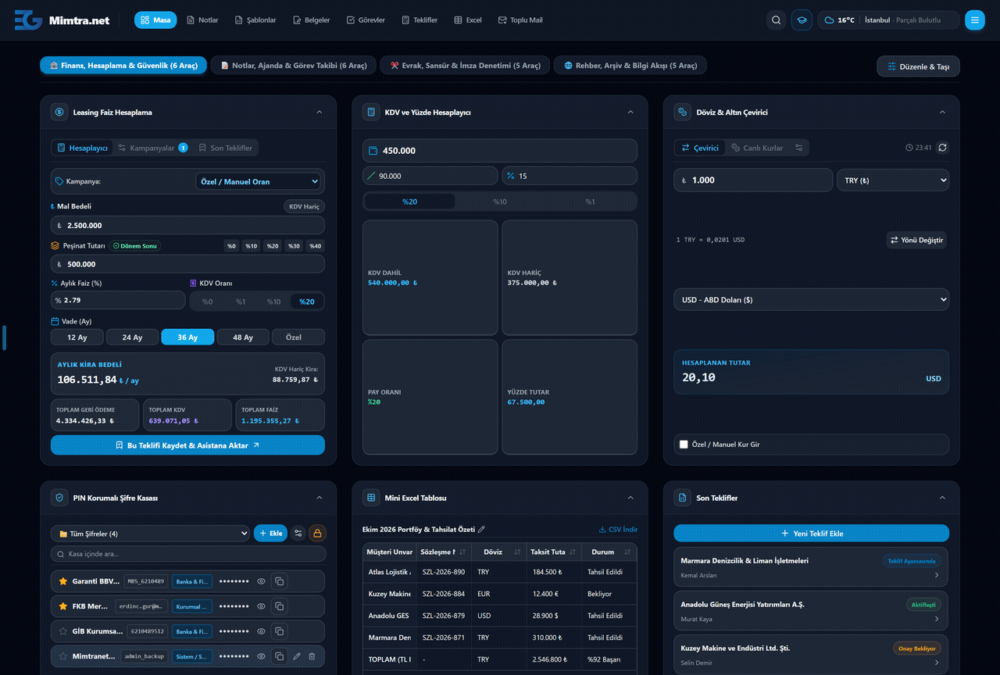

# Mimtranet 🚀
### Masaüstünüzün Bağımsız, Güvenli ve Dijital Verimlilik Kalesi

  
  
  
  
  

---

## 💡 Mimtranet Nedir ve Neden Hayatınızı Kolaylaştırır?

Günümüz iş hayatında çalışanların en büyük şikayetleri ortaktır:
- *Her küçük işlem için farklı bir yazılım açmak zorunda kalmak,*
- *Dağınık Excel dosyaları arasında kaybolmak,*
- *Müşteri sözleşmelerindeki `{isim}`, `{tutar}`, `{tarih}` alanlarını elle tek tek değiştirmeye çalışırken hata yapmak,*
- *TC Kimlik, IBAN veya özel şirket bilgilerini sansürlemek için Paint ile uğraşmak,*
- *Ve en önemlisi: Gizli kurumsal veya kişisel verilerin bulut sunucularına gitmesi endişesi.*

**Mimtranet işte tam bu sorunları çözmek için doğdu!**

Mimtranet; harici hiçbir sunucuya, kuruluma veya aboneliğe ihtiyaç duymayan; tüm stil, zengin metin editörleri, Excel hesaplama motorları ve veritabanını **tek bir bağımsız HTML dosyası (`mimtranet.html`)** içine toplayan hepsi-bir-arada (*all-in-one*) yerel intranet ve üretkenlik istasyonudur.

### 🎯 Uygulama Amacı ve Tasarım Felsefesi

- 🏢 **Bireysel Çalışanlardan Büyük Kurumsal Topluluklara:** Uygulama, ofis ortamında çalışan gerek tek bir kişi, gerekse büyük kurumsal topluluklar ve ekipler düşünülerek hazırlanmıştır.
- 🛡️ **IT / Bilgi Teknolojileri Kısıtlamalarına Takılmayan Güvenli Mimari:** Uygulama; web üzerinde harici sunucular aracılığı ile çalışan ve veri güvenliğini tehdit etme riskine karşı IT / Bilgi Teknolojileri kısıtlamalarına maruz kalan web uygulama araçlarının, kişisel bilgisayarlarda ve yalnızca yerel tarayıcı hafızası (`IndexedDB`) kullanılarak güvenli şekilde kullanımını sağlamak için tasarlanmıştır.
- 📦 **Kurulumsuz Kullanım & Taşınabilir Tek Dosya Deneyimi:** Uygulama, hiçbir kurulum veya ek yazılım gerektirmeden tek bir bağımsız web dosyasına (`mimtranet.html`) indirgenmiş olup doğrudan çift tıklamayla anında çalıştırılabilen eksiksiz bir kurulumsuz kullanım kolaylığı sağlar.

---

## ⚡ Kullanıcıya Sağladığı Benzersiz Ayrıcalıklar

1. 📥 **Sıfır Kurulum, Anında Kullanım (Zero-Setup):**
   Ne Node.js, ne Python ne de bir web sunucusu gerekir. İndirdiğiniz `mimtranet.html` dosyasına çift tıklayın; Chrome, Edge, Firefox veya Safari üzerinde anında açılsın.
2. 🛡️ **%100 Gizlilik ve Sıfır Veri Sızıntısı:**
   Verileriniz asla dışarıya çıkmaz. Notlarınız, yüklediğiniz Word ve Excel belgeleri, müşteri teklifleriniz ve şifreleriniz yalnızca sizin bilgisayarınızın yerel tarayıcı veritabanında (**IndexedDB**) güvenle saklanır.
3. 💼 **Tek Dosyada Taşınabilirlik:**
   İster USB belleğe atıp cebinizde taşıyın, ister masaüstünüzde tutun. Tüm çalışma alanınız tek bir dosya formatındadır.

---

## 🗂️ 22 Akıllı Araçlı Çok Sekmeli Çalışma Masası (Dashboard)

  

Masanızı dilediğiniz gibi düzenleyin! Üstelik tek bir masaüstü ile sınırlı değilsiniz: **Çoklu Sekme (Multi-Tab)** mimarisi sayesinde *"Finans Masası"*, *"Operasyon Paneli"*, *"Günlük İşler"* gibi dilediğiniz kadar sekme oluşturabilir; satır ve sütunları istediğiniz gibi sürükleyip yapılandırabilirsiniz.

İşte işinizi saniyeler içinde çözecek 22 güçlü araç:

| # | Araç Adı | Ne İşe Yarar? (Kullanım Amacı) | Hangi Durumda Hayat Kurtarır? |
| :-: | :--- | :--- | :--- |
| 1 | 📝 **Hızlı Not Ekle** | Başlık ve içerik zorunluluğu olmadan aklınıza gelen bir telefon numarasını, notu veya fikri anında kaydeder. | Telefonla konuşurken veya toplantı esnasında hızlıca not karalayıp kaybolmasını önler. |
| 2 | 📌 **Not Göster (Pano)** | Seçtiğiniz çok önemli bir notu veya talimat listesini sürekli masaüstünüzde açık ve görünür tutar. | Gün boyu elinizin altında olması gereken prosedürleri, IBAN numaralarını veya operasyon adımlarını sabitler. |
| 3 | 📄 **Son Notlar** | En son kaydettiğiniz veya güncellediğiniz notları tarih ve kategori etiketleriyle listeler. | Not defterine girmeden son çalışmalarınıza tek tıkla kaldığınız yerden devam etmenizi sağlar. |
| 4 | ⭐ **Favori Notlar** | Yıldızladığınız kritik notları doğrudan masaüstünüzde toplar. | Yüzlerce not arasından en sık başvurduğunuz rehberleri elinizin altına getirir. |
| 5 | ✅ **Hızlı İş Takip Listesi** | Öncelik sırasına göre acil yapılacak işleri işaretlenebilir onay kutularıyla sunar. | Günlük görevleri tamamladıkça tek tıkla üstünü çizerek motivasyonunuzu artırır. |
| 6 | 📑 **Metin & E-Posta Şablonları** | Sık gönderilen hazır yanıtları, e-posta taslaklarını parametreleriyle tek tıkla kopyalatır. | Her müşteriye aynı e-postayı sıfırdan yazma zahmetini bitirir; tek tıkla Outlook/Thunderbird taslağı açar. |
| 7 | 🖋️ **Belge Şablonları (Word/PDF)** | En sık kullanılan resmi dilekçe, talep formu ve sözleşme taslaklarını listeler. | Tek tıkla ilgili form doldurma ekranını açarak saniyeler içinde yeni bir resmi belge üretir. |
| 8 | ✂️ **Görsel Maskeleme (Sansürle)** | Taranmış evrak veya ekran görüntülerindeki TC Kimlik, IBAN, adres, tutar veya imzaları fırça ve dikdörtgen karartma ile sansürler. | Müşteriye veya dış taraflara sözleşme/dekont görseli atarken hassas verileri Paint'e gerek kalmadan 3 saniyede gizleyip temiz PNG indirmenizi sağlar. |
| 9 | ✍️ **Hızlı İmza Karşılaştırıcı** | İki adet imza görselini (örneğin imza sirküleri ile sözleşmedeki ıslak imzayı) yan yana ve **üst üste şeffaf katman olarak bindirerek** inceletir. | Sahte imza şüphesi olan durumlarda milimetrik zum ve opaklık kaydırıcısıyla imzanın birebir örtüşüp örtüşmediğini denetler. |
| 10 | 📁 **Evrak Ad ve Arşivlendirme (fileRenamer)** | Bir Outlook mesajını (`.msg`) veya klasörde gelen dosyaları sürükle-bırak yöntemiyle doğrudan içine bırakarak belgeleri otomatik ayıklar ve standart kurallara göre yeniden isimlendirir. | E-posta eklerini masaüstüne tek tek kaydedip elle isimlendirme zahmetini bitirir; karışık gelen müşteri evraklarını saniyeler içinde düzenli ve standart bir arşiv yapısına kavuşturur. |
| 11 | 🔒 **PIN Korumalı Şifre Kasası** | Kurumsal portallar, bankacılık şifreleri, FTP ve sistem girişlerini yerel olarak şifreleyip PIN kodu arkasında saklar. | Masadan kalktığınızda şifreler kilitlenir; tek tıkla kullanıcı adı ve parolayı panoya kopyalayarak formlara yapıştırmanızı sağlar. |
| 12 | 🏦 **Leasing Faiz Hesaplayıcı** | Mal bedeli (KDV dahil/hariç), peşinat, vade, aylık faiz oranı ve dönem başı / dönem sonu seçenekleriyle anında taksit ve geri ödeme planı hesaplar; kampanya oranlarını kaydeder. | Müşteri telefondayken saniyeler içinde alternatif ödeme planı çıkarıp tek tıkla doğrudan teklif yönetim ekranına aktarmanızı sağlar. |
| 13 | 🧮 **KDV ve Yüzde Hesaplayıcı** | Girilen ana tutar üzerinden seçilen KDV oranına (`%20`, `%10`, `%1`) göre aynı anda hem **KDV Dahil** hem **KDV Hariç** tutarı hesaplar; ayrıca **Pay Oranı** (bir tutarın ana tutara oranı) ve **Yüzde Tutar** (ana tutarın belirli bir yüzdesi) sonuçlarını canlı gösterir. | Fatura, peşinat, komisyon veya indirim hesaplarken "Bu tutarın KDV hariç matrahı neydi?", "Verilen peşinat toplam tutarın yüzde kaçına denk geliyor?" sorularını dört ayrı sonuç kartında anında yanıtlar. |
| 14 | 💱 **Döviz & Altın Çevirici** | Döviz (USD, EUR, GBP) ve altın kurlarını anlık paritelerle karşılıklı birbirine çevirir. | Yabancı para cinsinden teklif verirken ya da maliyet çıkarırken çapraz kurları anında hesaplar. |
| 15 | 📅 **Mini Takvim & Ajanda** | Aylık interaktif takvim üzerinde randevu, son teslim tarihi (termin) ve görevlerinizi takip etmenizi sağlar; yaklaşan etkinlikleri ve resmi/dini tatil günlerini kalan gün sayacıyla listeler. | Önemli beyanname, sözleşme teslimi ve müşteri toplantılarını unutmamanızı sağlar; resmi tatilleri ve bayramları tek bakışta görerek iş planınızı önceden yapmanıza yardımcı olur. |
| 16 | 📊 **Mini Excel Tablosu** | Masaüstünüzde hücreleri canlı düzenlenebilen, satır/sütun eklenebilen yerleşik mini elektronik tablo barındırır. | Günlük ufak hesaplamalar, hızlı tutar toplamları veya geçici veri tabloları için Excel programını açma hantallığını ortadan kaldırır. |
| 17 | 📋 **Son Teklifler** | Hazırlanan finansal teklifleri, müşteri unvanı, vade, tutar ve durum rozetleriyle özetler. | Hangi müşteriye ne zaman ne teklif verildiğini masaüstünden anında takip ettirir. |
| 18 | 👥 **Dahili Rehber & Hızlı Arama** | Şirket içi dahili telefon numaralarını, departmanları ve e-postaları anında filtreler. | "Muhasebenin dahili numarası kaçtı?" sorusuna anında arama kutusundan cevap verir. |
| 19 | 🔗 **Hızlı Bağlantılar** | Şirket içi ERP/CRM portalları, bankalar ve kamu siteleri için tek tıkla açılan kısayollar sunar. | Tarayıcınızın yer imleri çubuğundaki kalabalığı çalışma masanızda düzenli bir panoya dönüştürür. |
| 20 | 🗂️ **Evraklar & Belgeler Arşivi** | Masaüstünüzde bulunması gereken güncel sirküler, vergi levhaları veya kılavuzları saklar. | Dosya gezgininde klasör klasör belge arama derdini sonlandırır. |
| 21 | 📰 **RSS & Bilgi Akışı** | Mevzuat, sektör haberleri veya duyuruları içeren RSS beslemelerini canlı gösterir. | Çalışırken sektördeki güncel gelişmelerden ve resmi duyurulardan geri kalmamanızı sağlar. |
| 22 | 💻 **Özel HTML & Kod Çalıştırıcı** | Masaüstünüze özel widget, hava durumu eklentisi veya şirket içi duyuru panosu gömmenizi sağlar. | İhtiyacınıza göre masanızı sınırsız genişletme özgürlüğü tanır. |

---

## 🚀 Kapsamlı Ana Modüller ve İleri Düzey Yetenekler

### 1. ✉️ Toplu E-Posta Asistanı (Bulk E-Mail & EML Generator)
Otomatik e-posta gönderim altyapısına sahip olmayan ancak e-postalarını hızlıca hazırlamak isteyen, en azından SMTP sunucusu ile gönderim noktasına kadar gelebilen; Outlook üzerinden bir e-posta listesine gönderim yapmak isteyen ancak bunu tek tek yapmak zorunda kalan veya **Word > Outlook** ilişkisiyle *Word Posta Gönderimlerini (Mail Merge)* kullanamayan kişilerin hayatını kolaylaştırmak amacıyla geliştirilmiştir.
- **Excel'den Otomatik Veri Okuma:** Müşteri listenizi (.xlsx) yükleyin; sistem sütun başlıklarını anında dinamik değişkenlere (`{Unvan}`, `{Tutar}`, `{Vade}`) dönüştürsün.
- **Akıllı Gruplama & Sütun Toplamları:** Aynı müşteriye ait birden fazla borç/işlem satırını tek bir e-postada otomatik şık bir HTML tabloya toplar ve sütun toplamını hesaplar.
- **Toplu .EML & ZIP Çıktısı:** Hazırlanan yüzlerce kişiselleştirilmiş e-postayı tek tıkla Outlook/Thunderbird uyumlu `.eml` dosyaları olarak ZIP içinde indirir.

### 2. 📑 Akıllı Belge ve Sözleşme Doldurucu (Docx Engine)
Word şablonu oluşturma ve belge doldurma sürecinin çok daha pratik, hızlı ve kolay yöntemidir. Örnek olarak oluşturulan bir belge içerisindeki değerler hafızada tutulur; böylece başka bir belge hazırlanırken aynı verileri tekrar tekrar yazmak yerine tek tıkla hazır olarak kullanma imkanı sunar.
- **Word (.docx) Entegrasyonu:** Şirketinizin mevcut Word sözleşme, teklif, taahhütname veya muvafakatname gibi belgeleri sisteme yükleyin.
- **Otomatik Değişken Keşfi:** Belge içindeki `{Musteri_Adi}`, `{TC_Kimlik}`, `{Kira_Bedeli}` gibi tüm süslü parantezli alanlar otomatik algılanarak doldurulabilir bir forma dönüştürülür.
- **Tek Tıkla DOCX veya PDF İndirme:** Formu doldurun, tek tıkla orijinal biçimlendirmesi birebir korunmuş Word veya yüksek kaliteli PDF belgesi üretin.

### 3. 📊 Canlı Excel Sekmeleri & Formül Editörü
Hem Mimtranet'i hem de bilgisayarınızdaki Excel dosyalarını ayrı ayrı pencerelerde açmak yerine tek bir ekran üzerinden birlikte kullanabilmenizi sağlar. Uygulamanın genel arama alanı ile entegre çalışarak tablolarınız içindeki ilgili veriye saniyeler içinde ulaşmanıza olanak tanır.
- **Çoklu Sekme Açabilme:** Birden fazla Excel dosyasını tarayıcınızda aynı anda sekme sekme açın.
- **Gelişmiş Formül Motoru:** `SUM`, `TOPLA`, `AVERAGE`, `ORTALAMA`, `MIN`, `MAX`, `COUNT`, `SAY` gibi formülleri ve matematiksel işlemleri yerel olarak çalıştırır.
- **Canlı Hücre & Sütun Yönetimi:** Satır/sütun ekleyin, hücreleri düzenleyin, filtreleyin ve tek tıkla düzenlenmiş yeni `.xlsx` dosyası olarak indirin.

### 4. 📋 Görsel İş & Görev Takip Panosu (Kanban + Liste)
- **Sürükle-Bırak Kanban:** *Yapılacaklar*, *Devam Edenler*, *Tamamlananlar* sütunları arasında işlerinizi sürükleyerek yönetin.
- **Detaylı Liste Görünümü:** Büyük projeler için filtreleme ve sıralama destekli tablo görünümü.

### 5. 📝 Zengin Not Defteri
Günlük iş notlarınızı, toplantı tutanaklarınızı ve önemli çalışma rehberlerinizi alışkın olduğunuz bir kelime işlemci rahatlığında yazıp saklayabileceğiniz kişisel bilgi alanınızdır.
- **Zengin Yazım ve Biçimlendirme:** Yazı rengi, vurgu, tablolar, resimler, numaralı ve maddeli listeler ekleyerek notlarınızı düzenli ve okunaklı biçimde hazırlayın.
- **Kategoriler ve Favoriler:** Notlarınızı konularına göre kategorilere ayırın, en sık başvurduğunuz notları favorilere ekleyip üstte sabitleyin ve anlık arama ile aradığınız bilgiye hemen ulaşın.
- **Kolay Yedekleme:** Tüm notlarınızı tek tıkla bilgisayarınıza yedekleyin ve istediğiniz zaman geri yükleyin.

### 6. 🏦 Leasing Teklif & Süreç Yönetimi Asistanı
Finansal kiralama işlemlerinde önce **teklif sürecini** ve daha sonra **sözleşme sürecini** uçtan uca takip edebilmek amacıyla oluşturulmuştur. Gün içindeki çok fazla teklifin, müşteriden beklenen eksik belge ve bilgilerin kullanıcı tarafından unutulmadan, kolaylıkla takip edilebilmesini sağlar.
- Müşteri tekliflerini ve finansal kiralama sözleşme süreçlerini **Kanban Tahtası** veya **Klasik Liste** görünümüyle uçtan uca takip etme.
- Sözleşme bazlı özel **Kontrol Listesi (Checklist)**, iş günü sayacı ve zaman damgalı işlem notları.
- **Otomatik Şablon Tetikleyici:** Sözleşme statüsü değiştiğinde ilgili aşamaya tanımlanan e-posta/metin şablonunu otomatik olarak hazırlayıp ekrana getirme.

### 7. 🔍 Spotlight Hızlı Komut Paleti (`Ctrl + K`)
- Hangi sayfada olursanız olun klavyeden `Ctrl + K` (veya Mac'te `Cmd + K`) tuşlarına bastığınızda açılır.
- Tüm modüllere, şablonlara, notlara, rehbere ve ayarlara klavyenizden elinizi kaldırmadan 1 saniyede erişin.

### 8. 🎨 Gelişmiş Tema Motoru
- Göz yormayan **Karanlık Mod (Dark Mode)** ve aydınlık **Açık Mod**.
- 7 adet profesyonel kurumsal renk paleti: *Okyanus Mavisi, Zümrüt Yeşili, Menekşe Moru, Kalsit Turkuazı, Gün Batımı Turuncusu, Gül Pembesi ve Kehribar Sarısı*.

---

## 📥 Hemen İndirin ve Deneyin!

Çalışma alanınızı dijitalleştirmek ve üretkenliğinizi bir üst seviyeye taşımak yalnızca birkaç saniyenizi alır:

1. Depodaki **[mimtranet.html](mimtranet.html)** dosyasını indirin (Dosya sayfasına girip sağ üstteki **Download raw file** butonuna tıklayın).
2. İndirdiğiniz `mimtranet.html` dosyasına masaüstünüzde çift tıklayın.
3. Çalışma masanız, araçlarınız ve tüm verimlilik modülleriniz anında karşınızda!

---

## 📄 Lisans ve Telif Bilgisi

Bu proje **MIT Lisansı** altında sunulmaktadır. Ticari ve kişisel kullanımda tamamen özgürsünüz.

© 2026 Mimtranet | Geliştirici: **Erdinç Gür** ([rdncgr.tr](https://rdncgr.tr))
